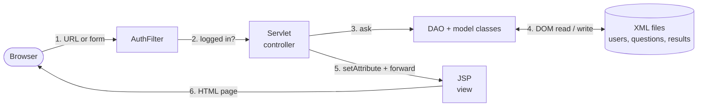
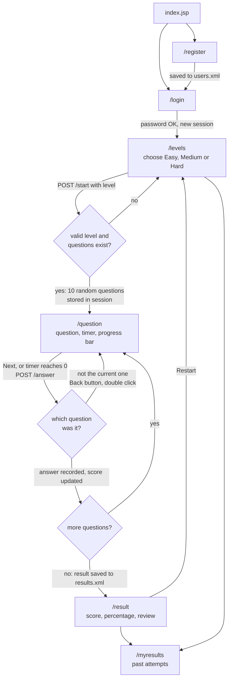
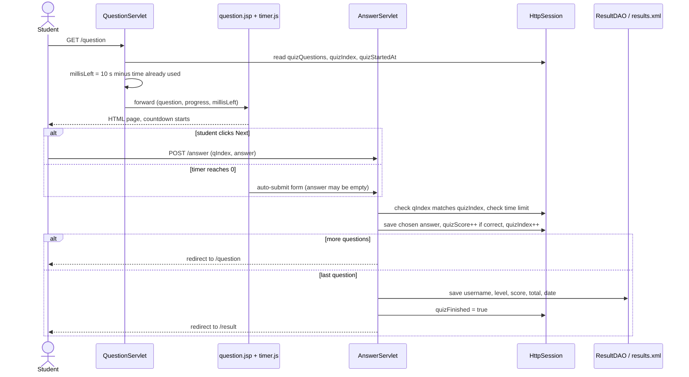
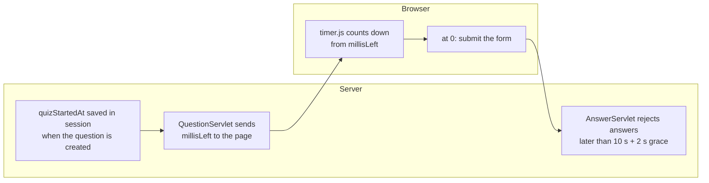
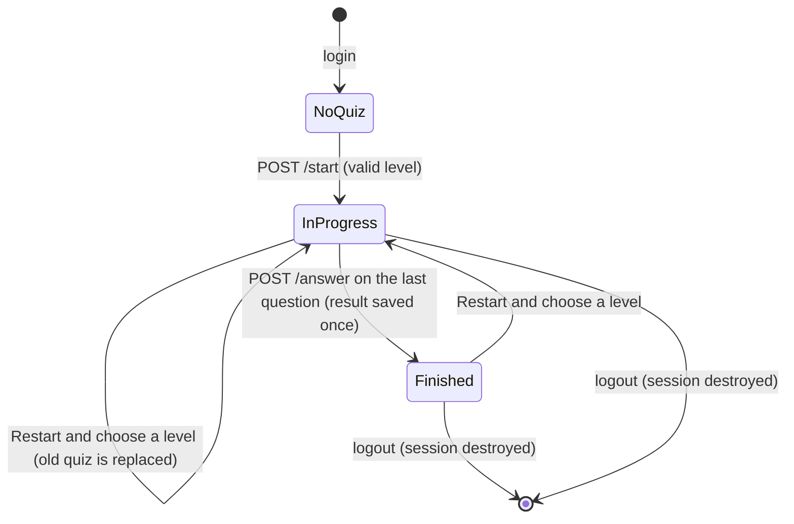

# Online Quiz Application - Tomcat 9 edition (Java Servlets + JSP + XML)

Student/admin login, Easy/Medium/Hard quizzes with a 10-second timer per question, progress bar,
score + percentage, answer review and "My Results". No Swing, no Spring, no database:
all data lives in XML files read/written with DOM.

**Demo logins:** `admin / admin123` (admin login page) and `student1 / student123` (or register a new student).

**Docs:** `VIVA_GUIDE.md` (team split, request flow, viva questions), `VIVA_CHEATSHEET.md` (one-page revision sheet), `DEMO_SCRIPT.md` (7-minute demo), `ECLIPSE_GUIDE.md`, `INTELLIJ_GUIDE.md`, `NETBEANS_GUIDE.md`.

## Folder structure

```
OnlineQuiz/
├── src/main/java/com/quiz/
│   ├── model/    User.java, Question.java, Result.java          plain data classes
│   ├── dao/      XmlHelper, UserDAO, QuestionDAO, ResultDAO, DataException   DOM read/write
│   ├── servlet/  controllers (below)
│   ├── filter/   AuthFilter.java       login / role check for protected URLs
│   ├── listener/ AppInitListener.java  picks the data folder, copies starter XML on startup
│   └── util/     AppConfig.java        constants (10 s, 10 questions, level names)
└── src/main/webapp/
    ├── index.jsp                       public landing page
    ├── css/style.css, js/timer.js      styling / the only JavaScript (countdown)
    └── WEB-INF/
        ├── web.xml                     welcome page, data folder setting, error pages
        ├── lib/                        2 JSTL jars (needed by <c:...> tags in JSP)
        ├── seed/                       starter questions.xml (36 questions), users.xml, results.xml
        └── views/                      all JSPs (hidden from direct URL access)
            ├── fragments/header.jspf, footer.jspf
            └── login, admin-login, register, admin-dashboard, add-question,
                select-level, question, result, my-results, error  (.jsp)
```

| File | Purpose |
|---|---|
| `User/Question/Result.java` | Model: one object per XML record |
| `XmlHelper.java` | Parse XML to DOM, save DOM to file (atomic), small helpers, the lock |
| `UserDAO.java` | Find user, check password hash (SHA-256), register student |
| `QuestionDAO.java` | Get questions by level, add question |
| `ResultDAO.java` | Save an attempt, list a user's attempts |
| `AppInitListener.java` | On Tomcat start: choose data folder, create XML files if missing |
| `AuthFilter.java` | Redirects not-logged-in users / wrong roles; disables page caching |
| `LoginServlet.java` | `/login` and `/adminlogin`: show form, verify, create session |
| `RegisterServlet.java` / `LogoutServlet.java` | Register with validation / end session |
| `AdminDashboardServlet.java`, `AddQuestionServlet.java` | Admin pages; add question to questions.xml |
| `LevelServlet.java` | Level choice page |
| `StartQuizServlet.java` | Pick 10 random questions of the level, store quiz in session |
| `QuestionServlet.java` | Show current question + remaining time (read-only) |
| `AnswerServlet.java` | Check answer, update score, next question or finish and save result |
| `ResultServlet.java`, `MyResultsServlet.java` | Result page, past attempts |
| `timer.js` | 10-second countdown, auto-submits the form at 0 |

## Setup (Eclipse + Tomcat 9 + JDK 11)

1. **Install JDK 11** (Temurin or Oracle; JDK 8 also works if you change `maven.compiler.release` in `pom.xml` to 8). Check with `java -version`.
2. **Install Tomcat 9.0.x**: download the "Core" zip from https://tomcat.apache.org/download-90.cgi and unzip, for example to `C:\tomcat9`. Tomcat 9 uses `javax.servlet` (this branch is written for it; the `main` branch is the Tomcat 10 / `jakarta.servlet` version).
3. **Use Eclipse IDE for Enterprise Java and Web Developers** (any recent version). The plain "Java" edition has no web tools.
4. **Register Tomcat in Eclipse:** Window > Preferences > Server > Runtime Environments > Add > *Apache Tomcat v9.0* > point to the Tomcat folder and choose JDK 11.
5. **Create the project:** File > New > Dynamic Web Project. Name `OnlineQuiz`, Target runtime *Tomcat 9.0*, Dynamic web module version **4.0**, tick *Generate web.xml* off. Finish.
6. **Copy the code in:** from this repo copy
   - `src/main/java/com/quiz` into the project's `src/main/java/com/quiz`
   - everything inside `src/main/webapp` into the project's `src/main/webapp` (Eclipse may call it `WebContent`; use whichever folder holds `WEB-INF`). Overwrite the generated `web.xml`.
   Refresh the project (F5). There should be no red errors. If `javax.servlet` is red, check step 4 and that the Tomcat runtime is selected under Project > Properties > Targeted Runtimes.
7. **Run:** right-click the project > Run As > Run on Server > Tomcat 9.0 > Finish. Open `http://localhost:8080/OnlineQuiz/`.
8. **Where is the XML data?** Folder `OnlineQuizData` in your user home (for example `C:\Users\you\OnlineQuizData`). The path is printed in the Console when the app starts. You can open the XML files in Eclipse to see registrations, results and new questions arrive. To change the folder, set `dataDir` in `web.xml`. Delete the folder to reset all data.
9. **Deploy a WAR on standalone Tomcat:** right-click project > Export > WAR file > `OnlineQuiz.war`, copy to `<tomcat>/webapps`, run `<tomcat>/bin/startup.bat`, open the same URL.

**Maven option (IntelliJ / NetBeans / command line):** the project has a `pom.xml`. Open it in your IDE, or run `mvn cargo:run` (downloads Tomcat 9 automatically) and open `http://localhost:8080/OnlineQuiz/`. `mvn package` builds `target/OnlineQuiz.war`. See `INTELLIJ_GUIDE.md` and `NETBEANS_GUIDE.md`.

**Need Tomcat 10 / 11 instead?** Use the `main` branch of this repository (`jakarta.servlet`).

**Common problems:** *404 after start* - use the project name in the URL (`/OnlineQuiz/`). *"Port 8080 in use"* - stop other Tomcat or change the port in Eclipse's Servers view. *JSTL / `c:` errors* - the two jars must be in `WEB-INF/lib`. *Changes not showing* - Servers view > right-click server > Clean.

## How the quiz works (flow diagrams)

The diagrams are Mermaid, so they display on GitHub. In an IDE, use the text next to each diagram.

### 1. The MVC layers

Every page follows the same path: the browser asks a servlet, the servlet uses a DAO to read or write XML, and then it forwards the data to a JSP that builds the HTML.



### 2. The student journey (every page and redirect)



Text version: `login > levels > start > question > answer > question ... > answer > result`. Restart goes back to `levels`.

### 3. One question, step by step

What happens between two questions. Note that `/answer` never shows a page: it saves the state and redirects.



### 4. The 10-second timer



Refreshing the page cannot reset the timer, because the start time is kept on the server. The JavaScript only displays the countdown and submits the form.

### 5. The quiz state in the session



| State | Session attributes | What `/question` and `/result` do |
|---|---|---|
| NoQuiz | only `user` | both redirect to `/levels` with a message |
| InProgress | `quizLevel, quizQuestions, quizIndex, quizScore, quizChosen, quizStartedAt`, `quizFinished=false` | `/question` shows the current question; `/result` redirects to `/question` |
| Finished | same, with `quizFinished=true` | `/question` redirects to `/result`; `/result` shows the review |

### 6. Where each piece of data lives

| Data | Stored in | Lives until |
|---|---|---|
| Logged-in user | session (`user`) | logout or 30 idle minutes |
| Current quiz (questions, index, score, answers) | session (`quiz*`) | next quiz, logout, or session timeout |
| Accounts, hashed passwords | `users.xml` | permanent |
| Questions | `questions.xml` | permanent |
| Finished attempts | `results.xml` | permanent |

## Edge cases handled

| Situation | What happens |
|---|---|
| Open any protected URL without logging in | `AuthFilter` redirects to login |
| Student opens `/admin/...` / admin opens quiz pages | Redirected to admin login / dashboard |
| Open a `.jsp` file directly | 404 (JSPs are under `WEB-INF`) |
| Start without a level / fake level | Back to level page with a message |
| Open `/question`, `/result` with no quiz | Back to level page |
| Refresh the question page | Same question, timer continues from the server's remaining time |
| Refresh the result page | Same result; it was saved once, not again |
| Back button to an old question / double click Next | Form carries `qIndex`; mismatch is ignored |
| Back after finishing | Redirected to result |
| Back after logout | Pages are `no-store`, browser re-asks the server, filter redirects |
| JavaScript disabled / very late answer | Server rejects answers after 10 s + 2 s grace |
| Duplicate username (any case), bad input, `<script>` in text | Validation messages; output escaped by `<c:out>` |
